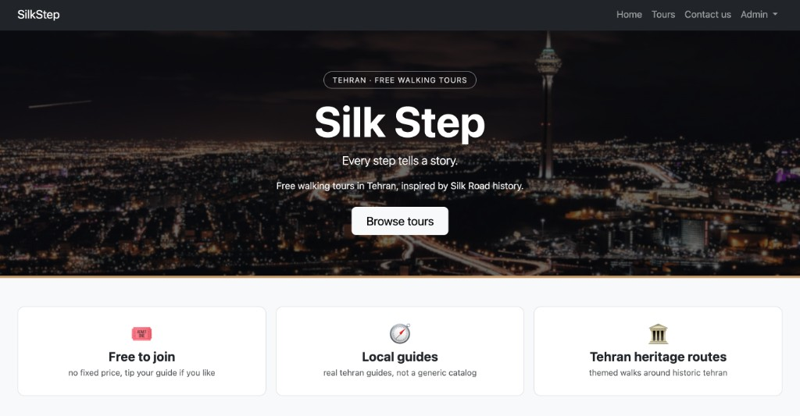

# SilkStep

**Every step tells a story.**

Free walking tours in Tehran — a full-stack web app for discovering routes, booking dates, and managing tours with local guides.

> **University project** — built for *Introduction to Web Applications* (2025/2026)  
> **Author:** Mohammad Keshmiri · `s308968`

**Live demo:** [mokeshmiri.pythonanywhere.com](https://mokeshmiri.pythonanywhere.com)  
**Repository:** [github.com/Mokeshmiri/SilkStep](https://github.com/Mokeshmiri/SilkStep)

---

## Preview



---

## About

SilkStep is a Flask web application inspired by free walking tour platforms, tailored for Tehran and Silk Road heritage routes. Guides publish weekly tours; participants browse, filter, and book spots; admins can review platform activity.

This repo is a coursework submission and portfolio piece — not a production service.

---

## Tech stack

| Layer | Tools |
|-------|--------|
| Backend | Python, Flask, Flask-Login |
| Database | SQLite (`silkstep.db`) |
| Frontend | HTML templates, Bootstrap 5, custom CSS/JS |

**Target device:** desktop (Bootstrap keeps layouts usable on smaller screens).

---

## Run locally

```bash
pip install -r requirements.txt
python3 app.py
```

Open [http://127.0.0.1:5001](http://127.0.0.1:5001).

The SQLite database is included with sample data — no extra setup needed.

---

## Test accounts

See `credentials.txt` for the full list. Quick logins:

| Role | Email | Password |
|------|-------|----------|
| Guide | guide1@test.com | pass123 |
| Participant | user1@test.com | pass123 |
| Admin | admin@test.com | admin123 |

You can register as a **participant** or **guide** (guides set spoken languages at signup and can edit them later). The **admin** account is seed-only.

---

## Features

### Core (course requirements)

- **Two roles:** guides create tours; participants book them (roles are enforced)
- **Guide languages:** stored on profile; only those languages appear when creating a tour
- **Tours:** title, weekly schedule (day + start time), meeting point, duration, language(s), max participants, 4+ stops, description, and 5 promotional photos
- **Browse & filter:** home + tours list, filter by date, duration, and language
- **Booking:** pick a date from the weekly schedule, 1–4 people (with names), capacity check per date, contact email/phone
- **Cancellation:** allowed only up to 24 hours before start time
- **Participant dashboard:** my bookings with date, time, meeting point, and party size
- **Guide dashboard:** reservations grouped by date with total expected attendees
- **Post-tour report:** for past dates with bookings — attendance + one photo
- **Tour management:** guides create, edit, and delete tours (locked after the first booking)
- **Admin panel:** counts, guides (with languages), participants, and all bookings
- **Account:** contact page, editable profile, change password, navbar dropdown

### Extras

**Homepage highlights** (three cards under the hero):

| Card | Description |
|------|-------------|
| Free to join | No paywall to browse or book — tip your guide if you like |
| Local guides | Real Tehran guides, not a generic catalog |
| Tehran heritage routes | Themed walks around historic Tehran |

**UI polish**

- Hero banner with gradient, tagline, and Tehran skyline background
- Square tour cards (`aspect-ratio 1:1`) for an even grid
- Photo gallery modal with prev/next arrows and keyboard navigation
- Live spots-left on the booking form (`/tour/<id>/availability`)
- Navbar name dropdown (profile, dashboard, logout)
- Form validation errors stay on the same page
- Tour stops on create/edit and tour detail pages
- Demo forgot-password page

---

## Deploy (PythonAnywhere)

1. Upload the project folder (or clone from GitHub).
2. Create a virtualenv and run `pip install -r requirements.txt`.
3. Add a new web app → manual config → Flask, pointing at the venv.
4. Edit the WSGI file to import the app:

```python
import sys
path = "/home/<username>/SilkStep"
if path not in sys.path:
    sys.path.append(path)
from app import app as application
```

5. Map static files: URL `/static/` → `/home/<username>/SilkStep/static`.
6. Ensure `silkstep.db` is uploaded (includes sample data).
7. Reload the web app.

---

## Project structure

```
app.py              routes + Flask-Login
helpers.py          photo, schedule, and parsing helpers
*_dao.py            database access (one file per domain)
user_model.py       user class for Flask-Login
templates/          HTML pages
static/css/         custom styles
static/images/      backgrounds and README preview image
static/uploads/     tour photos
schema.sql          full DB structure (reference)
seed.sql            sample accounts
silkstep.db         SQLite database with sample data
credentials.txt     test logins
```

---

## License

[MIT](LICENSE) © 2026 Mo Keshmiri
